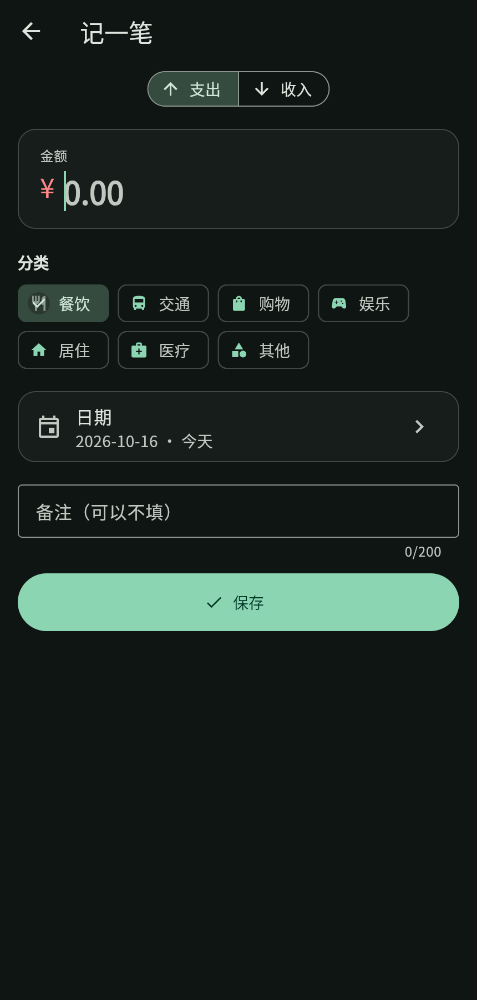
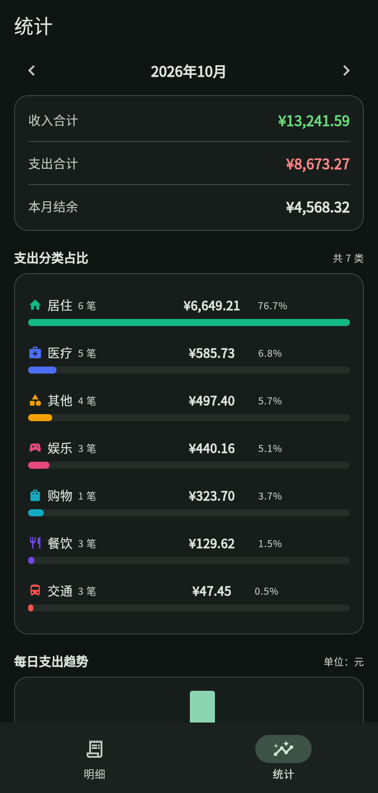

# MoneyNote —— 双端原生记账 App

一个**从零开始、用 AI 协作完成**的移动端项目：一套 Dart 代码，编译成 Android 和 iOS 两个平台的真原生 App，配一个自己的后端 API。

做这个项目的**唯一目的**，是让你能给 `ltx@techlz.com` 发一封有东西可看的邮件。

---

## 先搞清楚三件事，能省你两个星期

**1. 「项目链接」大概率指 GitHub 仓库，不是线上网址。**
招聘方要看的是你写的代码。所以把代码传到 GitHub 就够了，公网部署后端是加分项、不是必需项（见 [06](docs/06-部署后端到公网.md)）。

**2. iOS 真原生必须有 macOS 才能编译，这是硬约束，绕不过去。**
你现在是 Windows。本项目的方案是：日常开发在 Windows 上做 Android，需要 iOS 成品时用**云端 macOS**（免费额度够用）。具体见 [05](docs/05-录屏与打包.md)。

**3. 「vibe coding」不等于「让 AI 写完就行」。**
面试官一定会追问你的代码。答不上来，这个项目反而变成减分项。方法见 [04](docs/04-用AI写代码.md)——**这份文档比代码本身重要**。

---

## 30 秒跑起来

```bash
# 1. 后端
cd backend
npm install
npm run seed
npm run dev          # 停在 http://localhost:3000

# 2. App（另开一个终端）
cd app
flutter pub get
flutter run
```

现在就能看到界面了。跑不起来就查 [09 排错速查](docs/09-排错速查.md)。

---

## 四周排期

假设你每天能投入 3 小时。

| 周 | 做什么 | 完成的标志 |
|---|---|---|
| **第 1 周** | 装环境，跑通后端和 App | 模拟器里能看到首页和 60 多条假数据 |
| **第 2 周** | 读代码 + 改功能 | 能自己加一个新分类；能解释每个文件在干嘛 |
| **第 3 周** | 打包 + 录屏 + 传 GitHub | 手机上有 App；有一段 90 秒的录屏 |
| **第 4 周** | 准备面谈 + 发邮件 | 邮件已发出，8 个高频问题能张口就答 |

**别压缩第 2 周。** 跳过它，你就只是"有个项目的搬运工"，面试第一个问题就露馅。

---

## 项目长什么样

App 有三个界面：

- **明细** — 顶部是本月结余 / 收入 / 支出卡片，下面是按日期分组的流水，可以切月份、筛选收支、下拉刷新
- **记一笔** — 选支出或收入、填金额、点分类图标、选日期、写备注
- **统计** — 分类占比横条图 + 每日支出趋势柱图

| 明细 | 记一笔 | 统计 |
|---|---|---|
|  |  |  |

> 这三张是**真实运行截图**，不是效果图：Flutter 编译成网页版后跑在浏览器里，
> 数据全部来自本项目的后端接口。截图脚本在[附录](#附录怎么重新生成上面这三张图)。

功能不花哨，但每一处都能讲出为什么：断网了会怎样、切月份切太快会怎样、金额为什么不能用小数存。

---

## 代码结构

```
demo0/
├── README.md              ← 你在这
├── docs/                  ← 操作手册，按顺序看
├── .github/workflows/     ← 自动构建：iOS 模拟器录屏、网页版部署
├── scripts/               ← 一键测试、截图、工作流检查
├── run-tests.bat          ← 双击它 = 跑下面那套测试
├── backend/               ← Node + Express + SQLite 后端
│   ├── src/
│   │   ├── db.js          打开数据库、建表
│   │   ├── repo.js        所有 SQL。换数据库只改这里
│   │   ├── routes.js      参数校验 + 路由。不碰 SQL
│   │   ├── server.js      中间件、统一错误出口、启动
│   │   └── seed.js        演示数据生成
│   ├── scripts/smoke.js   75 条断言的冒烟测试
│   └── README.md          接口文档
└── app/                   ← Flutter 前端
    ├── lib/
    │   ├── main.dart      入口，组装依赖
    │   ├── core/          配置、日期金额格式化、分类定义
    │   ├── models/        数据结构 + JSON 互转
    │   ├── data/          网络、缓存、仓库
    │   ├── state/         全局状态（ChangeNotifier）
    │   ├── widgets/       可复用组件
    │   └── pages/         三个页面
    └── test/              纯函数单元测试
```

---

## 文档怎么用

**按顺序看，别跳。**

| 文档 | 什么时候看 |
|---|---|
| [01 环境搭建](docs/01-环境搭建.md) | 第一次，装 Flutter 和 Android Studio |
| [02 跑通后端](docs/02-跑通后端.md) | 装完环境，验证后端 |
| [03 跑通 App](docs/03-跑通App.md) | 后端通了，把 App 跑起来 |
| [04 用 AI 写代码](docs/04-用AI写代码.md) | **第 2 周开始，反复看** |
| [05 录屏与打包](docs/05-录屏与打包.md) | 第 3 周 |
| [06 部署后端到公网](docs/06-部署后端到公网.md) | **想让"电脑关机了 App 还能用"就做这个**（含免费方案对比 + 国内访问实测）。做网页版前也必须做 |
| [07 发邮件给 HR](docs/07-发邮件给HR.md) | 第 4 周，最后一步 |
| [08 面试准备](docs/08-面试准备.md) | 第 4 周，反复看 |
| [09 排错速查](docs/09-排错速查.md) | 任何时候卡住了 |
| [10 测试指南](docs/10-测试指南.md) | **零基础也能做**，跑通代码之后就看 |
| [11 上传到 GitHub](docs/11-上传到GitHub.md) | 第 3 周。**"项目链接"就是它** |
| [12 部署到网页端](docs/12-部署到网页端.md) | 加分项：让 HR 点开就能用 |
| [13 只有安卓怎么测](docs/13-只有安卓怎么测.md) | **只有安卓手机、没有 Mac**，却要证明"双端"。从零到交付的完整一条路 |

---

## 测试：双击一个文件就行

项目根目录的 **`run-tests.bat`**，双击它。它会依次跑四件事 ——
工作流检查、后端接口测试、App 静态检查、App 单元测试 —— 最后打印一行结论。

第一步（[`scripts/check-workflows.mjs`](scripts/check-workflows.mjs)）是专门拦一类坑的：
`.github/workflows/` 里的 yml 引用了一个不存在的步骤 id、或者一个没声明的输入框，
**本机怎么跑都是好的，要推到 GitHub 才会第一次炸**，而那时候一次要等 20 分钟。
这一条一秒钟出结果，把等待省掉。

全部通过的截图可以直接放进简历。详细说明见 [10 测试指南](docs/10-测试指南.md)。

---

## 哪些是验证过的，哪些不是

我把话说清楚，别到时候踩坑。

### 验证环境

| | 版本 |
|---|---|
| Flutter | 3.47.7 stable（Dart 3.13.5） |
| Node.js | 24.15.0 |
| 系统 | Windows 11 |

### 已经真跑过、有输出的

**后端 —— 全部通过。**

| 命令 | 结果 |
|---|---|
| `npm install` | 67 个包，5 秒 |
| `npm run smoke` | **75 条断言全部通过** |
| `npm run seed` | 生成 65 条数据 |
| 真启服务 + `curl` 打真实请求 | 中文、金额精度、错误码全部正确 |
| 访问日志 | 每个请求打一行 `[状态码] 方法 路径 (耗时) 时间`，实测输出正确。真机调试时靠它确认"操作真的到了服务器" |
| `AUTO_SEED=1` 空库自动补数据 | 实测三种情况：空库 → 自动写入 65 条；已有数据 → **跳过且不删**（手动插的记录重启后仍在）；不设这个变量 → 空库保持为空（所以 smoke 的空库断言不受影响） |

**App —— 编译、测试、浏览器实测，全过。**

| 命令 | 结果 |
|---|---|
| `flutter pub get` | Got dependencies |
| `flutter analyze` | **No issues found!**（0 error / 0 warning / 0 info） |
| `flutter test` | **All tests passed!**（53 个） |
| `flutter build web --release` | √ Built build\web |

#### `.github/workflows/` 里的两个工作流 —— 静态检查通过，而且反向验证过

检查器是 [`scripts/check-workflows.mjs`](scripts/check-workflows.mjs)。它在两个 yml 上都报了绿，
但"报绿"本身说明不了什么 —— 所以分别注入了三种故障，确认它**真的会红**：

| 注入的故障 | 期望 |
|---|---|
| 删掉 `id: sim` | ✅ 报红，4 处引用全部指出"这个 job 里没有 id: sim" |
| 把 `echo "udid=…"` 改成 `echo "udid2=…"` | ✅ 报红，并打印"它写过：udid2" |
| 引用一个没声明的输入 `record_secs` | ✅ 报红，并列出已声明的输入 |

三种都抓到，改回后仍绿（文件 md5 校验与注入前一致）。

> ⚠️ 这个检查器**只查引用对不上**，不查 YAML 缩进、也不保证镜像标签
> 和 action 版本还有效 —— 那些真跑一次才知道。它拦的是"最浪费时间、
> 又最容易在本地查出来"的那一类。它自己也有过两次误报（不认
> `echo "k=v" >>` 写法、不按 job 分作用域），都是实测发现的，注释里写了。

**浏览器端到端实测 —— 这一步比编译更能说明问题。**

Flutter 编译成网页版跑起来，连本机后端，用 headless 浏览器把三个界面都截了图
（就是上面那三张）。核对过：

- 三个界面全部正常渲染，中文、图标、配色都对
- 页面上的数字和后端接口返回的**逐项一致**
  （结余 ¥4,568.32 / 收入 ¥13,241.59 / 支出 ¥8,673.27 / 27 笔，
  统计页 7 个分类的金额和占比也全部对得上）

### 没验证过的，别当成已验证

| 事项 | 为什么没验证 |
|---|---|
| **Android APK 真机安装** | 这台机器没装 Android SDK 和模拟器，见 [01](docs/01-环境搭建.md) |
| **iOS 编译** | **必须有 macOS**，Windows 上做不到，见 [05](docs/05-录屏与打包.md) |
| **两个 GitHub 工作流真跑一次** | 本目录**还不是 git 仓库**（`git status` 报 not a repository），代码没推到 GitHub，workflow 从没被 GitHub 解析过。只做了[静态检查](#githubworkflows-里的两个工作流--静态检查通过而且反向验证过)，那查不到镜像标签和 action 版本是否还有效 |
| **Docker 镜像构建** | 这台机器没装 Docker（`which docker` 找不到），`backend/Dockerfile` **从未真正构建过**。见 [06 §用 Dockerfile 部署](docs/06-部署后端到公网.md) |
| **Render 免费档真能跑起来** | 要有一个 Render 账号才能创建服务，我只能在本地查文档、测延迟。"免费档能用新加坡"这条已经查证（官方 Regions 文档 + 状态页有 `Singapore - Web Services - Free Tier` 组件），但**服务能不能成功部署没试过**。见 [06](docs/06-部署后端到公网.md) |
| **其他云平台的免费额度** | Fly.io / Railway / Koyeb / Zeabur 的免费政策都改过好几轮（Fly.io 2024-10 取消，Koyeb 2026-02 对新用户关闭……），我查到的是二手来源、没能对到官网原文。**以官网为准** |
| **YouTube/Google 系服务的可达性** | 与项目无关，仅说明本机网络环境 |

也就是说：**代码在编译和逻辑层面是干净的，界面在浏览器里是亲眼确认过的；
但"装到手机上是什么样"必须你自己跑一遍第 3 周。**

### 已经抓出来并修掉的真 bug

这些都是实际踩到的，不是编的。面试时每一个都能展开讲。

| # | 问题 | 为什么值得讲 |
|---|---|---|
| 1 | 月份加减 `(m-1) ~/ 12` | Dart 的 `~/` 是**向零截断**，`(-1) ~/ 12 == 0`，导致「2026-01 往前一个月」算成 `2026-12`。**手工点不出来**，得正好在 1 月点"上个月"。写单元测试时才炸出来 |
| 2 | 金额传 `0.001` 返回 500 | 分的整数化之后是 0，插库时约束报错。该给 400 却给了 500，前端只能显示"服务器错误" |
| 3 | `amount: true` 被当成 1 元 | `Number(true) === 1`，JS 的类型转换把布尔值悄悄变成了合法金额 |
| 4 | 切到没缓存的月份，列表还是上个月的 | 空缓存分支忘了清空列表 —— 标题写着 9 月，底下是 10 月的账。**比"白屏"更坏，因为用户看不出来** |
| 5 | 记账时中文提示写成 `'$monthLabel(month)结余'` | Dart 把 `$monthLabel` 当成变量插值，界面上会直接显示一段函数源码 |
| 6 | `kIsWeb` 用之前没 import | `package:flutter/material.dart` **并不导出** `kIsWeb`，编译直接报 `Undefined name`。网上"不用额外 import"的说法是错的 |
| 7 | 翻到 2028 年再点「日期」→ 界面崩 | 日期选择器的**可选范围围着「今天」定，初始值却来自「当前在看的月份」**。翻得够远，初始值就掉到范围外，内部断言直接失败。手工能复现，但你得先想到"翻到两年后试试" |
| 8 | `offset=99999999999999999999` 返回 500 | `Number.isInteger(1e20)` 是 `true` —— 双精度浮点眼里的"整数"，SQLite 的 64 位整数却装不下。该 400 的参数错误报成了 500，还把内部错误码漏给了客户端 |
| 9 | `category: ["餐饮"]` 被静默存成 `"餐饮"` | `String(body.x ?? '')` 会隐式转换：数组、数字、布尔全被"转"成字符串。前端传错类型，后端一声不吭收下 |
| 10 | 后端挂掉时，统计页显示一排 `¥0.00` | `stats ?? MonthStats.empty` 把"加载失败"伪装成"这个月没记账"。两者界面上一模一样 —— **用户会拿着一个假结论去做决定** |
| 11 | 某月超 1000 条时，同一屏两个数字对不上 | 列表写死 `limit=1000` 不翻页，而顶部"笔数"来自统计接口的真实值。卡片说 1001 笔、列表只有 1000 行，还少一条看不到 |
| 12 | `API_BASE_URL` 末尾多个斜杠 → **每个请求都 404** | 地址是拼出来的（`'$baseUrl$path'`），带斜杠就成了 `https://x.com//api/health`。双斜杠**不是**等价写法（实测 404）。偏偏云平台给你的地址经常自带斜杠，复制粘贴最容易中招 —— 而报错会把你往"后端没部署好"上带 |
| 13 | **`app/android/` 和 `app/ios/` 这两个目录根本不存在** | 最狠的一个：它不报错，只是让你**先付出几小时**（装 Android Studio、配 SDK、下载几个 G），最后才告诉你"找不到 Android 工程"。失败出现在你投入之后，而不是之前。已用 `flutter create --platforms` 补齐 |
| 14 | Web 部署时 `API_BASE_URL` 没配 → **绿勾但站点是坏的** | 未设置的仓库变量会展开成空字符串，App 于是回落到 `http://localhost:3000`（= 访客自己那台电脑）。构建成功、部署成功、Actions 一颗绿勾，点开却永远连不上。已在构建前加了一道 fail-fast 检查 |

| 15 | 首页汇总卡把"加载失败"显示成 `¥0.00` | 和上面第 10 条**是同一个病，但在另一张卡上**。统计页早就改成显示「—」了，首页却漏了：拿不到数据时用 `stats ?? MonthStats.empty` 兜底，四个数字全变成实实在在的 0，跟"这个月真没花钱"长得一模一样。**同一个原则，修了一处、漏了一处** —— 这才是它值得讲的地方 |

> 第 12 ~ 14 条都是**只在"部署"这个环节才暴露**的问题——
> 本机怎么跑都是好的。这类问题的共同点是：**报错信息指向的地方，
> 和真正的原因不是同一个地方**。所以每一条都配了断言或检查，而不是靠人记得。

第 7 ~ 11 条是同一类问题的不同面孔，都指向一句话：
**别把"我不知道"渲染成"确实是零/没有"。** 这是这个项目里最值得讲的一类 bug。

这类 bug 就是招聘方想通过面谈筛掉的东西。**所以请务必做完第 2 周。**

---

## 附录：怎么重新生成上面这三张图

上面三张截图是用 Chrome DevTools Protocol 驱动 headless 浏览器拍的，
脚本在 [`scripts/shoot.mjs`](scripts/shoot.mjs)。它比 `--screenshot` 参数强在两点：
能精确指定视口尺寸（否则拍出来右边会被切掉），以及**能点击**（所以能拍到第二、第三个界面）。

```bash
cd backend && npm run dev            # 终端 1
cd app && flutter run -d web-server --web-port 8080   # 终端 2
node scripts/shoot.mjs docs/images   # 终端 3
```

平时用不上，只有想更新 README 配图时才跑。
